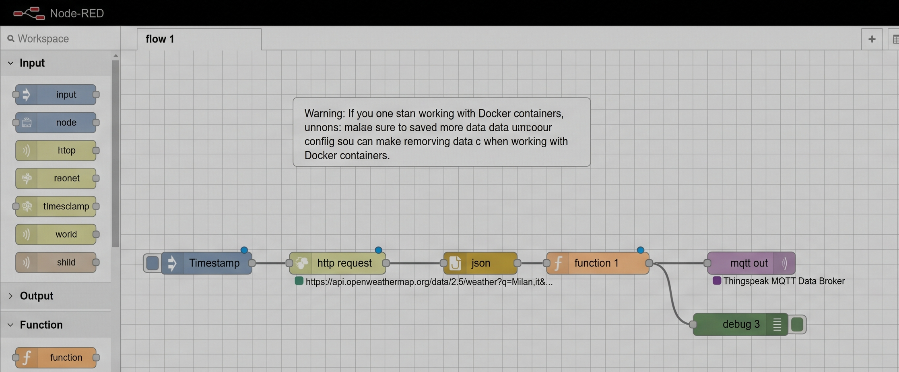

# weather_monitoring
# Milan Weather Monitoring Pipeline (Node-RED + MQTT + ThingSpeak)

An automated IoT data pipeline built with **Node-RED** that periodically fetches real-time weather data for Milan, Italy, transforms the payload, and publishes temperature and humidity telemetry to **ThingSpeak** via **MQTT**.



## Architecture & Data Flow

1. **Trigger (`inject`):** Fires automatically at startup and repeats every hour (`3600` seconds).
2. **Data Ingestion (`http request`):** Queries the OpenWeatherMap Current Weather API (`q=Milan,it`) to retrieve raw meteorological telemetry.
3. **Parsing (`json`):** Converts the raw HTTP text response into a structured JavaScript object.
4. **Transformation (`function`):**
   - Converts ambient temperature from Kelvin to Celsius (`temp - 273.15`, rounded to 3 decimal places).
   - Extracts relative humidity (`main.humidity`).
   - Formats the payload into ThingSpeak's MQTT field syntax (`&field1=<temp>&field2=<humidity>`) and sets the target topic (`channels/<CHANNEL_ID>/publish`).
5. **Telemetry Publishing (`mqtt out` & `debug`):** Publishes the formatted string to the ThingSpeak MQTT broker (`mqtt3.thingspeak.com:1883`) while logging payloads to the debug sidebar.

## Repository Structure

```text
├── assets/
│   └── noderedflow.png        # Visual overview of the Node-RED workspace
├── flows/
│   └── progetto_monitoraggio_meteo.json              # Exported Node-RED flow configuration
└── README.md
